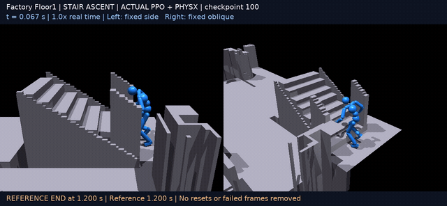
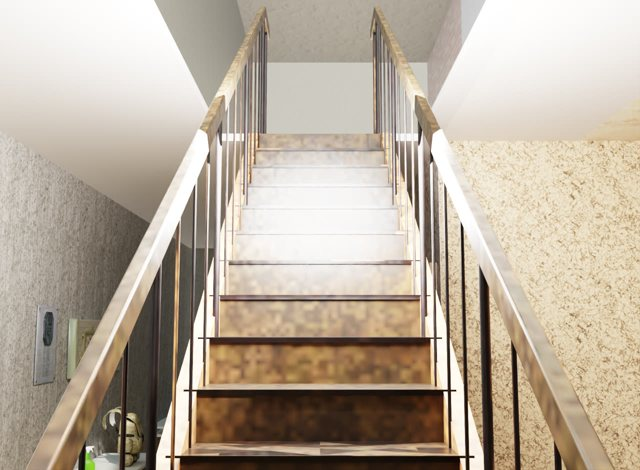
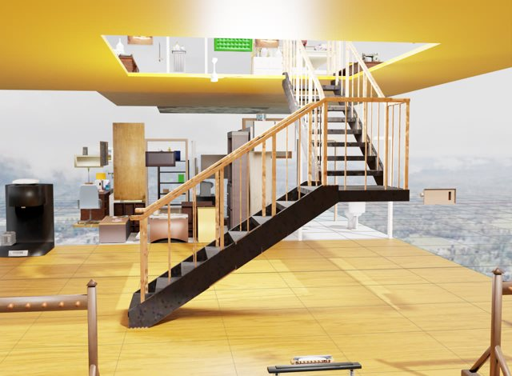
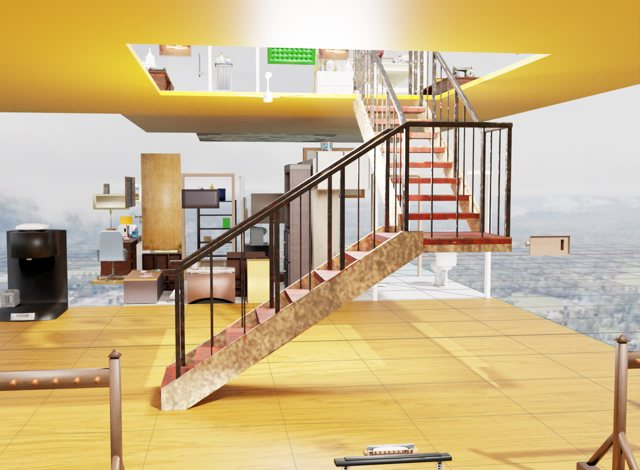

  

  
  
  
  
  

## About

I'm **Ma Yixing (Jimmy)**, a Computer Science with AI student at the **University of Nottingham**.
I build **simulation-ready 3D environments for humanoid robots**: multi-storey buildings whose storeys,
stairs and colliders are checked to be walkable *before* a policy ever trains in them.

- **Research interests:** embodied AI, humanoid locomotion, procedural 3D scene generation, physics simulation
- **How I work:** every acceptance check ships with a negative control. If a gate cannot fail, it is not measuring anything.
- **Currently:** connecting generated buildings to humanoid motion training in ProtoMotions / PARC

## Featured research

### [Buildings-Generation](https://github.com/JIMMY081105/Buildings-Generation)

Turn a multi-storey building into one a simulated humanoid can actually walk through: find its storeys,
design and place a staircase that connects them, bake the result to a voxel cache, and run geometric
acceptance gates that are built to fail.

  
   
  A humanoid policy climbing a flight this pipeline designed, placed, baked and accepted.
  Geometry from Buildings-Generation; policy trained separately in ProtoMotions / PARC.

<table>
  <tr>
    <td align="center" width="33%"> eye-level approach</td>
    <td align="center" width="33%"> L-shaped</td>
    <td align="center" width="33%"> U-shaped</td>
  </tr>
</table>

- **Any building type.** A house, a factory, a school and a warehouse differ in a YAML profile, not in the code path.
- **Gates that can fail.** Each check has a negative control. Applying the body radius to the whole
  reachability flood, not just to seed selection, took the same 50 buildings from 50/50 passing to 0/50.
- **One CLI.** `buildingsgen scan` finds storeys; `buildingsgen run` connects, bakes and accepts.

### [Humanoid-Training-Scene-Ready-Generation](https://github.com/JIMMY081105/Humanoid-Training-Scene-Ready-Generation)

An automation, benchmarking and quality-gate layer on top of [SceneSmith](https://github.com/nepfaff/scenesmith),
run on a SLURM HPC cluster. It adds per-room quality gates, gated scene assembly, a benchmark of Codex CLI as a
VLM/agent backend, and a memory-safe headless Blender renderer. Only my own layer is published; changes to
upstream files ship as reviewable diffs.

## Projects

| Project | What it is | Stack |
|---|---|---|
| [Buildings-Generation](https://github.com/JIMMY081105/Buildings-Generation) | Storey detection, staircase placement, voxel baking and acceptance gates for multi-storey buildings | Python · OpenUSD |
| [Humanoid-Training-Scene-Ready-Generation](https://github.com/JIMMY081105/Humanoid-Training-Scene-Ready-Generation) | Quality gates and HPC automation for SceneSmith scene generation | Python · SLURM · Blender |
| [Scientific-Machine-Learning-Peking-Module](https://github.com/JIMMY081105/Scientific-Machine-Learning-Peking-Module) | Peking University SciML module: numerical solving, optimisation, autodiff, physics-informed networks | Julia · Jupyter |
| [Intrusion-Detection-System-IDS-](https://github.com/JIMMY081105/Intrusion-Detection-System-IDS-) | Metaheuristic feature selection and hyper-parameter tuning for intrusion detection | Python |
| [Algorithm-comparisons-between-optimized-and-greedy-algorithms](https://github.com/JIMMY081105/Algorithm-comparisons-between-optimized-and-greedy-algorithms) | Smart waste-clearance routing: optimised vs greedy algorithms | C++ |
| [Car-Warehouse-Management-System-using-C-](https://github.com/JIMMY081105/Car-Warehouse-Management-System-using-C-) | Warehouse management system for a car enterprise | C++ |
| [ReadVault](https://github.com/JIMMY081105/ReadVault) | Offline-first reading hub: ebook reader, library and reading calendar as an installable PWA | React · TypeScript · Vite |
| [Tetris-using-Java](https://github.com/JIMMY081105/Tetris-using-Java-.) | Tetris in Java | Java |

Also: [Farmer-Buddy](https://github.com/JIMMY081105/Farmer-Buddy) (team mobile app, fork) ·
[Agriculture chatbot](https://github.com/JIMMY081105/Agriculture-chatbot-using-gemini-flash) ·
[Rice-type classification](https://github.com/JIMMY081105/Rice-type-classification) ·
[SceneSmith](https://github.com/JIMMY081105/Scenesmith) (fork of the ICML 2026 code release)

## Tech stack

    
    
  
  
  
  

## Live on GitHub

<picture>
  <source media="(prefers-color-scheme: dark)" srcset="https://raw.githubusercontent.com/JIMMY081105/JIMMY081105/output/stats-dark.svg">
  
</picture>

<picture>
  <source media="(prefers-color-scheme: dark)" srcset="https://raw.githubusercontent.com/JIMMY081105/JIMMY081105/output/github-snake-dark.svg">
  
</picture>

**Recently active**

<!-- LIVE:RECENT:START -->
- `2026-10-17` [**Buildings-Generation**](https://github.com/JIMMY081105/Buildings-Generation) — Generate, connect and accept multi-storey simulation-ready buildings of any type — geometric storey…
- `2026-09-14` [**Grand-Library**](https://github.com/JIMMY081105/Grand-Library)
- `2026-07-23` [**Scientific-Machine-Learning-Peking-Module**](https://github.com/JIMMY081105/Scientific-Machine-Learning-Peking-Module) — Julia-based scientific machine learning course materials from Peking University: lecture notes, notebooks…
- `2026-07-21` [**Sustainability-Theory-and-Practices**](https://github.com/JIMMY081105/Sustainability-Theory-and-Practices) — The module is about understanding complex sustainability problems and developing practical, evidence-based…
- `2026-07-15` [**Humanoid-Training-Scene-Ready-Generation**](https://github.com/JIMMY081105/Humanoid-Training-Scene-Ready-Generation)
<!-- LIVE:RECENT:END -->

Header is a hand-built animated SVG (<code>scripts/build_hero.py</code>).
Stats, the contribution snake and the recent list refresh daily via GitHub Actions.

